# How We Work
Updated whenever docs/WORKFLOW.md Protocols change.

## The loop

```mermaid
flowchart LR
    Feras["Feras"] --> Opus["Opus chat"]
    Opus --> Brief["Brief"]
    Brief --> Pipeline["Builder pipeline (agy/cf/oc)"]
    Pipeline --> BuildGate["Build gate"]
    BuildGate --> CrossReview["Cross-review (other model family)"]
    CrossReview --> OpusGate["Opus gate"]
    OpusGate --> EyeGate["Eye gate"]
    EyeGate --> Main["main"]
    Main --> Handoff["Handoff"]
    Handoff --> Calendar["Calendar + feras/BRIEFING.md"]
    Calendar --> Plays["Feras plays"]
    Plays --> Queue["Notes back to the queue"]
    Queue --> Opus
```

## Roles
| | Feras | Opus chat | Builders (agy, cf, oc) | Haiku / review-* agents |
|---|---|---|---|---|
| Decides | scope, story, art, spending, models, releases | nothing final: advises with a pick | nothing | nothing |
| Does | plays builds, makes art, logins, "spend ok" | plans, briefs, reviews, merges, MCP art work | code, tests, docs, reviews | big reads, review lenses |
| Reports | notes after each play | the 5-part report + calendar | .result + log | a findings list |

The 5-part report at the end of every chat: Done | Still open | When (calendar day) | How (lane, who) | Your move vs mine.

## Cost rules
- One task per chat, a fresh chat per request: cheapest call is one with a small context.
- Batch: one tool call that does three things beats three calls; don't wait turn by turn on background jobs.
- Builders write, Opus briefs and gates: a builder run costs Claude only the brief (~2k) and the gate read.
- Trim connectors per task: toggle off unused MCP tools (Gmail, Drive, Docs, Cloudflare, Rodin, Blender, OpenRouter) to save ~20k prefix tokens per call.
- The advisor once, at start, on chats over ~100k; skip the closing call on small changes.
- Write code with Write/Edit tools, not shell heredocs.
- Cache TTL: don't leave tasks idle over an hour mid-work; avoid toggling connectors mid-chat.
- Hand off before context reaches compaction (~250k tokens) or ~85% of the 5-hour window.

## This week (Claude Pro weekly limit: ~75% used Wed 10-28, resets Sat 10-31 13:00 UTC = 16:00 Feras's time (GMT+3); on his calendar)
| Day | Plan |
|---|---|
| Wed 10-28 | Row 1 closed (personas tailored, on main); Feras OKs docs/VISION.md. |
| Thu 10-29 | Rows 12 + 15 closed (cross-review on both sides, TOP line in the session hook); process review written. |
| Fri 10-30 | Row 3 M1 brief (Feras answers its feel questions); row 4 agy builds overnight. Feras: art homework, Bilqis call. |
| Sat 10-31 | Limit resets 16:00: row 4 review + eye gate (cross-reviewed); row 6 Roya bake. |
| Sun-Mon | Play day 1 (row 5) on PC and phone; fix passes from his notes; rows 7-8. |
