# How We Work
Updated whenever docs/WORKFLOW.md Protocols change.

## The loop

```mermaid
flowchart LR
    Feras["Feras"] --> Opus["Opus chat"]
    Opus --> Brief["Brief"]
    Brief --> Pipeline["Builder pipeline (agy/cf/oc)"]
    Pipeline --> BuildGate["Build gate"]
    BuildGate --> CrossReview["Cross-review (other model family)"]
    CrossReview --> OpusGate["Opus gate"]
    OpusGate --> EyeGate["Eye gate"]
    EyeGate --> Main["main"]
    Main --> Handoff["Handoff"]
    Handoff --> Calendar["Calendar + feras/BRIEFING.md"]
    Calendar --> Plays["Feras plays"]
    Plays --> Queue["Notes back to the queue"]
    Queue --> Opus
```

## Roles
| | Feras | Opus chat | Builders (agy, cf, oc) | Haiku / review-* agents |
|---|---|---|---|---|
| Decides | scope, story, art, spending, models, releases | nothing final: advises with a pick | nothing | nothing |
| Does | plays builds, makes art, logins, "spend ok" | plans, briefs, reviews, merges, MCP art work | code, tests, docs, reviews | big reads, review lenses |
| Reports | notes after each play | the 5-part report + calendar | .result + log | a findings list |

The 5-part report at the end of every chat: Done | Still open | When (calendar day) | How (lane, who) | Your move vs mine.

## Cost rules
Cost = model calls x context size (each call re-reads the whole chat from cache at ~1/10 price).
- A new multi-step task opens a fresh chat; a follow-up of up to ~10 tool calls stays (its cache is cheaper).
- Parallel tool calls in one message; never chained shell (the worktree guard refuses it).
- Builders write, Opus briefs and gates: a builder run costs Claude only the brief and the gate read.
- Waiting on a builder: the cache waker (tools/wait_run.sh) wakes the chat at 50 min so the 1-hour cache never
  expires; an overnight run or a chat past 200k hands off at launch instead.
- Connectors: Gmail, Google Docs, the second Rodin and Cloudflare bindings are off; Drive stays (Feras 10-29). Never
  toggle connectors mid-chat (a changed prefix is a full cache miss).
- The advisor only with Feras's OK. Scripts go through Write/Edit, never python heredocs (a hook blocks them).
- Hand off at a unit boundary past ~250k context or ~85% of the 5-hour window (a hook warns at 200k and at 10M reads).

## Who syncs, where you see things
- Syncing: the father chat. Children work in their own worktrees (one writer per set of files, so no conflicts); the
  father merges each, runs every check, merges to main and updates your checkout (sync_main.sh).
- Reports: feras/BRIEFING.md (newest first) at every /handoff; the chat's last message; your calendar's "Your moves
  today:"; HANDOFF "Open points" for anything agreed but not done, with its owner.
- Every problem or fix Claude names carries a status: done | in progress | planned (when) | not planned | waiting on
  Feras.

## The week
HANDOFF.md "This week" and Feras's calendar ("Your moves today:" events) hold it; this page never copies it.
